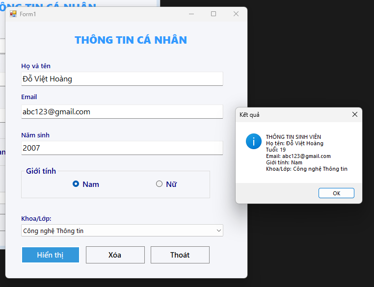

# Bài Lab 01 - Ứng dụng thông tin cá nhân

- **Học phần:** COMP1019 - Lập trình trên Windows
- **Họ và tên:** Đỗ Việt Hoàng
- **MSSV:** 51.01.104.031
- **Lớp:** 51.CNTT.A
- **Công cụ:** Visual Studio, Windows Forms App (C#)

## 1. Mô tả bài toán

Ứng dụng Windows Forms cho phép nhập thông tin cá nhân của sinh viên (họ tên, năm sinh, email, giới tính, khoa) và hiển thị kết quả tổng hợp bằng MessageBox sau khi nhấn nút **Hiển thị**.

## 2. Cấu trúc thư mục

```
Lab01
|-- Lab01.slnx
|-- Lab01_ThongTinCaNhan
|   |-- Form1.cs
|   |-- Form1.Designer.cs
|   `-- Program.cs
`-- images
    `-- hien_thi.png
```

## 3. Giao diện

| Control | Tên | Chức năng |
| --- | --- | --- |
| Label | lblTitle | Tiêu đề chương trình |
| TextBox | txtHoTen | Nhập họ tên |
| TextBox | txtNamSinh | Nhập năm sinh |
| TextBox | txtEmail | Nhập email |
| RadioButton | radNam, radNu | Chọn giới tính (đặt trong GroupBox) |
| ComboBox | cboKhoa | Chọn khoa |
| Button | btnHienthi | Hiển thị thông tin |
| Button | btnXoa | Xóa dữ liệu đã nhập |
| Button | btnThoat | Thoát chương trình |

## 4. Chức năng

- **Khi mở chương trình:** ComboBox khoa có sẵn 3 lựa chọn: Công nghệ Thông tin, Hóa học, Vật lý.
- **Nút Hiển thị:** kiểm tra dữ liệu, nếu hợp lệ thì hiển thị thông tin sinh viên (họ tên, tuổi, email, giới tính, khoa) bằng MessageBox.
- **Nút Xóa:** xóa các TextBox, bỏ chọn giới tính, bỏ chọn khoa.
- **Nút Thoát:** hiện hộp thoại xác nhận Yes/No trước khi đóng chương trình.

## 5. Kiểm tra dữ liệu nhập

- Họ tên không được rỗng.
- Năm sinh phải là số nguyên, trong khoảng từ 1900 đến năm hiện tại.
- Email không được rỗng.
- Phải chọn giới tính.
- Phải chọn khoa.

Khi dữ liệu sai, chương trình hiện MessageBox cảnh báo và không xử lý tiếp.

## 6. Kết quả

Nhập: Họ tên = Đỗ Việt Hoàng, Năm sinh = 2007, Email = abc123@gmail.com, Giới tính = Nam, Khoa = Công nghệ Thông tin.



Chương trình hiển thị:

```
THÔNG TIN SINH VIÊN
Họ tên: Đỗ Việt Hoàng
Tuổi: 19
Email: abc123@gmail.com
Giới tính: Nam
Khoa/Lớp: Công nghệ Thông tin
```

Tuổi được tính bằng: năm hiện tại - năm sinh.

## 7. Cách chạy chương trình

1. Clone repo về máy.
2. Mở file `Lab01/Lab01.slnx` bằng Visual Studio.
3. Nhấn **F5** để chạy.
