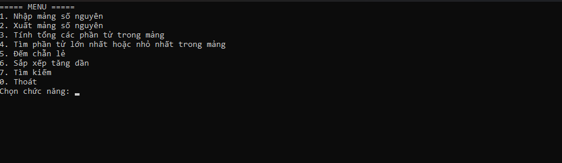
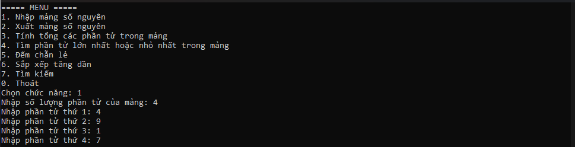
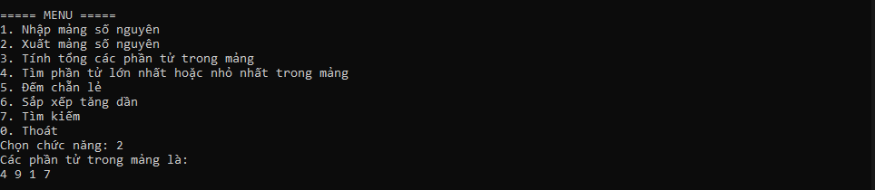
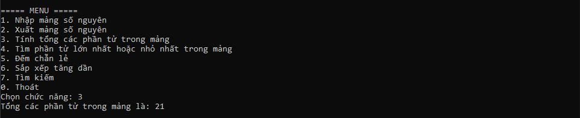
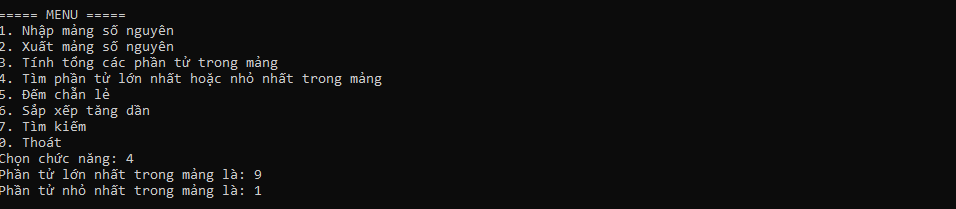
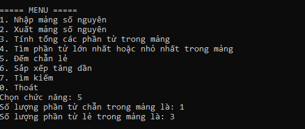
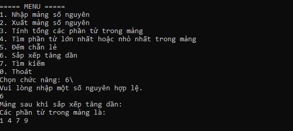
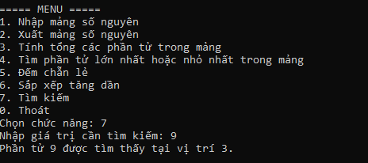
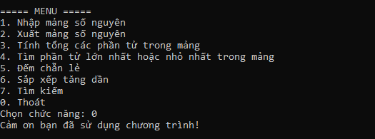

# Bài Lab 02 - Quản lý mảng số nguyên bằng Console

- **Học phần:** COMP1019 - Lập trình trên Windows
- **Họ và tên:** Đỗ Việt Hoàng
- **MSSV:** 51.01.104.031
- **Lớp:** 51.CNTT.A
- **Công cụ:** Visual Studio, Console App (C#, .NET 10)

## 1. Mô tả bài toán

Chương trình Console C# quản lý một mảng số nguyên. Chương trình hiển thị menu để người dùng chọn chức năng, thực hiện xong thì quay lại menu cho đến khi chọn Thoát.

## 2. Cấu trúc thư mục

```
Lab02
|-- Lab02.slnx
|-- Lab02
|   |-- Lab02.csproj
|   `-- Program.cs
|-- images
`-- README.md
```

## 3. Chức năng

| Lựa chọn | Chức năng | Mô tả |
| --- | --- | --- |
| 1 | Nhập mảng | Nhập số lượng phần tử n (nguyên dương), sau đó nhập n phần tử |
| 2 | Xuất mảng | In toàn bộ phần tử của mảng |
| 3 | Tính tổng | Tính và in tổng các phần tử |
| 4 | Tìm max/min | In giá trị lớn nhất và nhỏ nhất |
| 5 | Đếm chẵn/lẻ | In số phần tử chẵn và số phần tử lẻ |
| 6 | Sắp xếp tăng dần | Sắp xếp mảng và in kết quả |
| 7 | Tìm kiếm | Nhập x, in vị trí xuất hiện đầu tiên (tính từ 0) nếu có |
| 0 | Thoát | Kết thúc chương trình |

## 4. Kỹ thuật

- Tách chương trình thành các phương thức: `HienThiMenu`, `NhapSoNguyen`, `NhapSoNguyenDuong`, `NhapMang`, `XuatMang`, `TinhTong`, `TimMax`, `TimMin`, `DemChan`, `DemLe`, `SapXepTangDan`, `TimKiem`.
- Kiểm tra dữ liệu nhập: số lượng phần tử phải là số nguyên dương, giá trị nhập sai kiểu thì yêu cầu nhập lại, lựa chọn menu không hợp lệ thì báo lỗi.
- Không cho thực hiện các chức năng 2 đến 7 khi chưa nhập mảng.
- Chương trình không bị dừng đột ngột khi nhập sai dữ liệu.

## 5. Kết quả chạy

Dữ liệu thử: mảng gồm 4 phần tử `4 9 1 7`.

### 5.1. Menu chính



### 5.2. Nhập mảng



### 5.3. Xuất mảng



### 5.4. Tính tổng

Tổng = 4 + 9 + 1 + 7 = 21.



### 5.5. Tìm giá trị lớn nhất và nhỏ nhất

Lớn nhất = 9, nhỏ nhất = 1.



### 5.6. Đếm số chẵn và số lẻ

Có 1 số chẵn (4) và 3 số lẻ (9, 1, 7).



### 5.7. Nhập sai dữ liệu và sắp xếp tăng dần

Khi nhập lựa chọn không phải số nguyên hợp lệ, chương trình báo lỗi và yêu cầu nhập lại. Sau khi nhập đúng, mảng được sắp xếp thành `1 4 7 9`.



### 5.8. Tìm kiếm phần tử

Mảng đã sắp xếp `1 4 7 9`, tìm x = 9 cho kết quả vị trí 3 (tính từ 0).



### 5.9. Thoát chương trình



## 6. Cách chạy chương trình

1. Clone repo về máy.
2. Mở file `Lab02/Lab02.slnx` bằng Visual Studio.
3. Nhấn **F5** để chạy.