# Bài Lab 04 - Exception, Delegate/Event, Func/Action và Generic

- **Học phần:** COMP1019 - Lập trình trên Windows
- **Họ và tên:** Đỗ Việt Hoàng
- **MSSV:** 51.01.104.031
- **Lớp:** 51.CNTT.A
- **Công cụ:** Visual Studio, Console App (C#, .NET 10)

## 1. Mô tả bài toán

Chương trình Console quản lý sản phẩm. Dữ liệu lưu trong bộ nhớ bằng `Repository<T>`. Chương trình xử lý lỗi nhập liệu, mã sản phẩm trùng và sản phẩm không tồn tại bằng exception phù hợp, thông báo bằng event khi thêm hoặc xóa thành công.

## 2. Cấu trúc thư mục

```
Lab04
|-- Lab04.slnx
|-- Lab04
|   |-- Lab04.csproj
|   |-- IEntity.cs
|   |-- Product.cs
|   |-- ProductExceptions.cs
|   |-- Repository.cs
|   |-- ProductService.cs
|   `-- Program.cs
|-- images
`-- README.md
```

## 3. Các thành phần chính

| Thành phần | Nội dung |
| --- | --- |
| `IEntity` | Interface có `string Id { get; }`, làm ràng buộc generic cho `Repository<T>` |
| `Product` | Thuộc tính `MaSP`, `TenSP`, `Price`, `Quantity`; có constructor, `ToString`; mã và tên không rỗng, đơn giá và số lượng không âm |
| `DuplicateProductException` | Exception tự tạo, phát sinh khi thêm sản phẩm trùng mã |
| `ProductNotFoundException` | Exception tự tạo, phát sinh khi xóa sản phẩm không tồn tại |
| `Repository<T>` | Generic class `where T : IEntity` có `Add`, `Remove`, `FindById`, `Find`, `GetAll` |
| `ProductService` | `AddProduct`, `RemoveProduct`, `Search`, `Filter`, `TinhTongGiaTriKho`; phát event `ProductAdded`, `ProductRemoved` |
| `Program` | Menu, nhập xuất dữ liệu, bắt exception |

## 4. Chức năng

| Lựa chọn | Chức năng | Mô tả |
| --- | --- | --- |
| 1 | Thêm sản phẩm | Nhập mã, tên, đơn giá, số lượng; mã không rỗng, không trùng |
| 2 | Xuất danh sách | In toàn bộ sản phẩm, danh sách rỗng thì có thông báo |
| 3 | Tìm theo mã | In thông tin sản phẩm nếu tìm thấy |
| 4 | Tìm theo tên | In các sản phẩm có tên chứa từ khóa |
| 5 | Lọc theo khoảng giá | Dùng `Func<Product, bool>` để lọc |
| 6 | Xóa sản phẩm | Xóa nếu tồn tại và phát event |
| 7 | Tính tổng giá trị kho | Tổng của đơn giá x số lượng |
| 0 | Thoát | Kết thúc chương trình |

## 5. Kỹ thuật đã áp dụng

- **Exception:** 2 exception tự tạo, dùng `try-catch` ở `Program`, nhập sai dữ liệu không làm chương trình dừng.
- **Event:** `ProductAdded` và `ProductRemoved` (kiểu `Action<Product>`), `Program` đăng ký để in thông báo `[Event]`.
- **Func:** `Func<Product, bool>` dùng trong tìm theo tên và lọc theo khoảng giá.
- **Generic:** `Repository<T>` với ràng buộc `where T : IEntity`.
- Tách chương trình thành các class và file riêng, `Main` chỉ điều khiển luồng.

## 6. Kết quả chạy

Dữ liệu thử: `SP01 - Chuột - 150000 - 20`, `SP02 - Bút bi - 5000 - 100`, `SP03 - Bàn phím - 400000 - 10`.

### 6.1. Menu chính

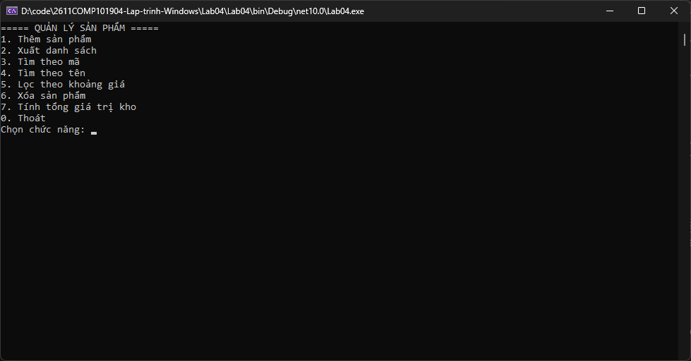

### 6.2. Xuất danh sách khi chưa có sản phẩm

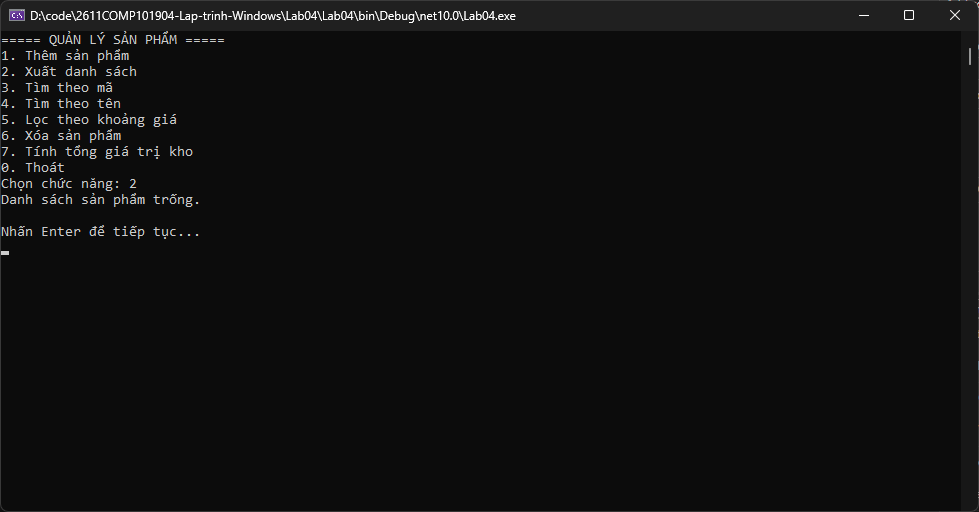

### 6.3. Thêm sản phẩm (có event thông báo)

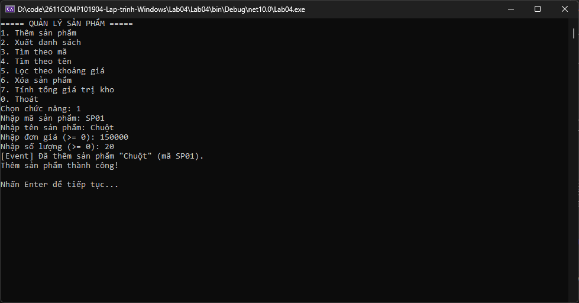

### 6.4. Xuất danh sách

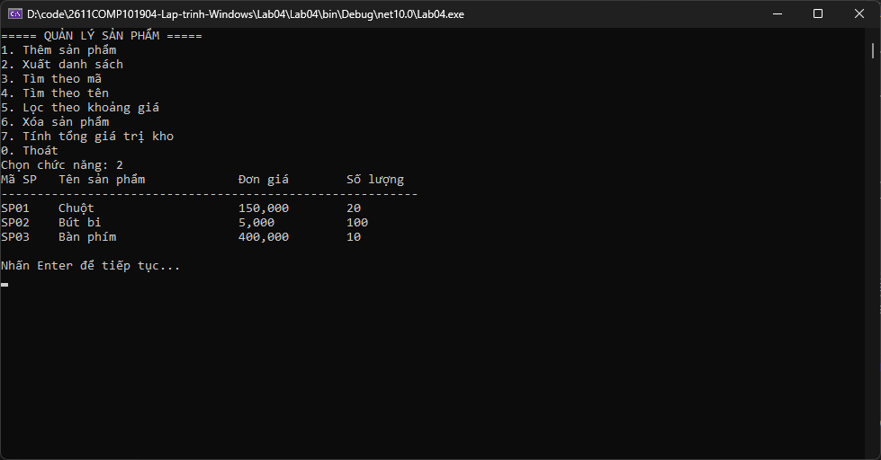

### 6.5. Tìm theo mã


### 6.6. Tìm theo tên

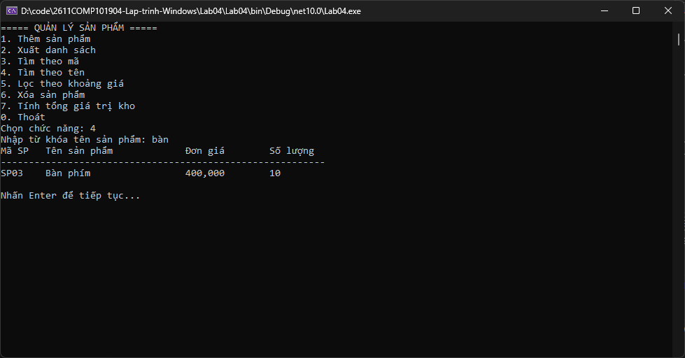

### 6.7. Lọc theo khoảng giá

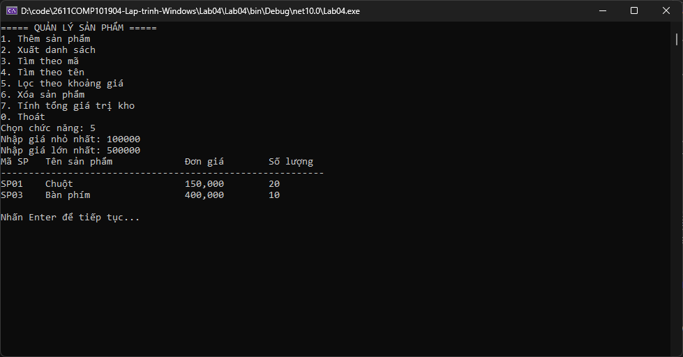

### 6.8. Tính tổng giá trị kho

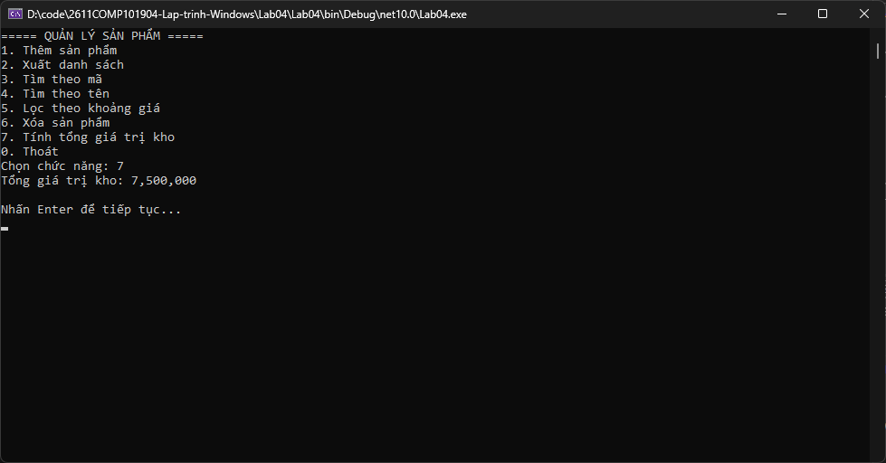

### 6.9. Xóa sản phẩm (có event thông báo)


## 7. Kiểm tra lỗi

### 7.1. Thêm sản phẩm trùng mã

Chương trình ném `DuplicateProductException` và báo mã đã tồn tại.

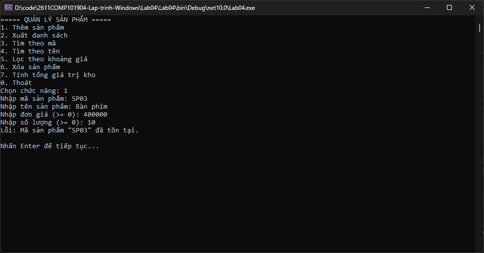

### 7.2. Xóa sản phẩm không tồn tại

Chương trình ném `ProductNotFoundException` và báo không tìm thấy sản phẩm.

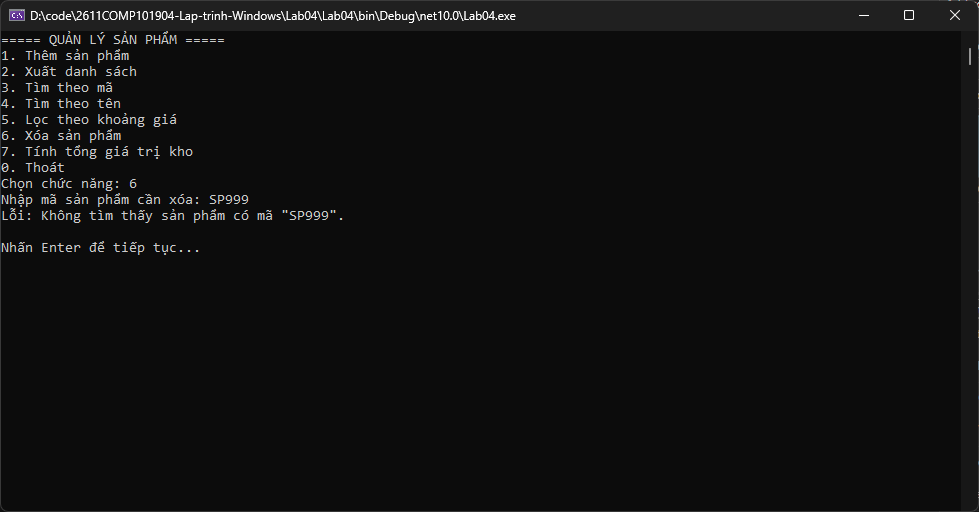

### 7.3. Nhập sai dữ liệu

Mã hoặc tên để trống, đơn giá hoặc số lượng âm hay sai kiểu: chương trình báo lỗi và yêu cầu nhập lại.

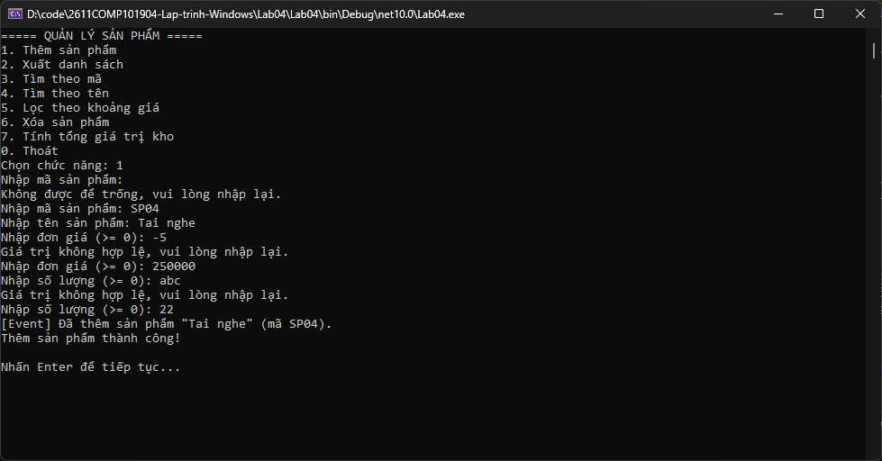

## 8. Thoát chương trình

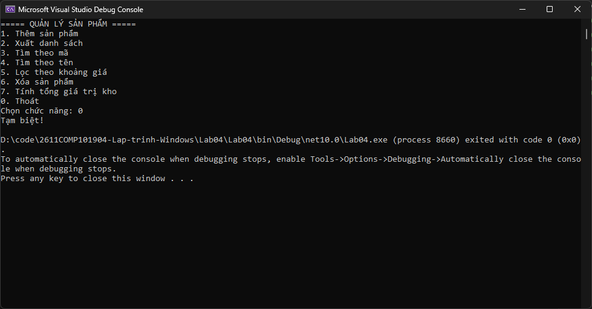

## 9. Cách chạy chương trình

1. Clone repo về máy.
2. Mở file `Lab04/Lab04.slnx` bằng Visual Studio.
3. Nhấn **F5** để chạy.
