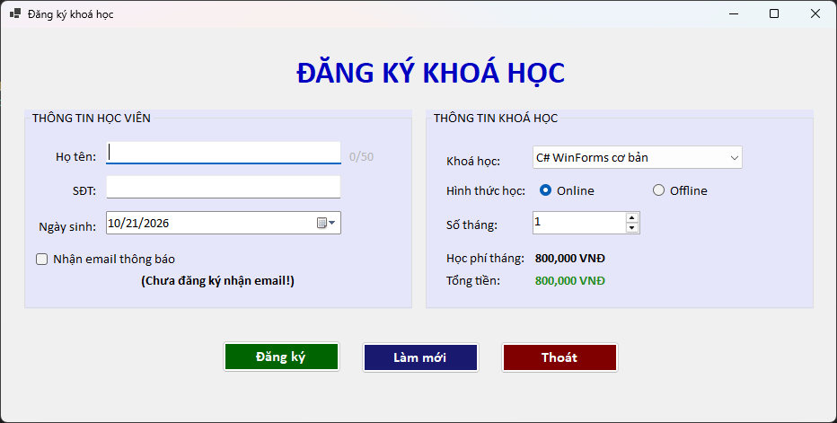
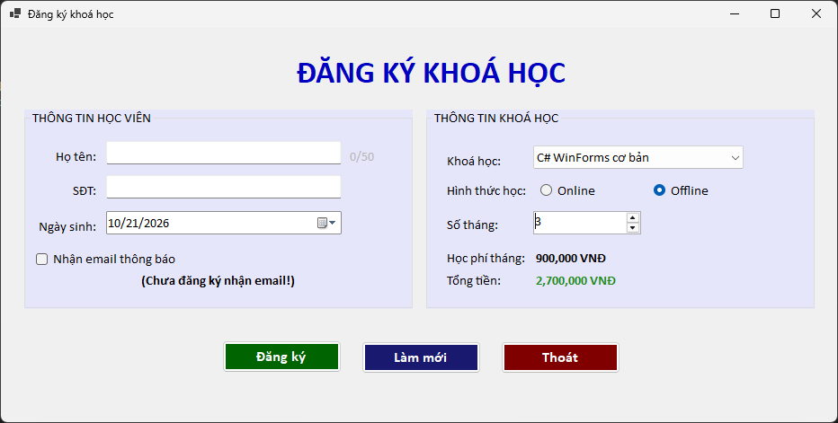
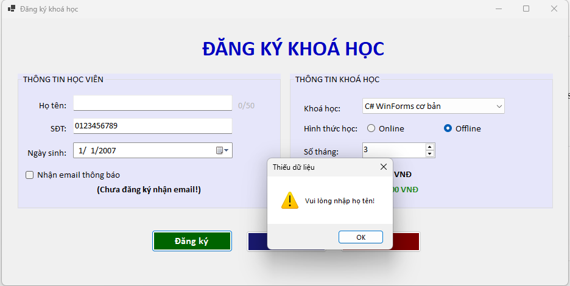
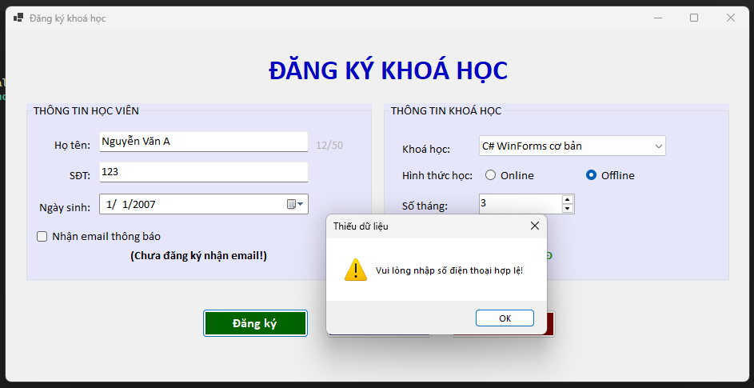
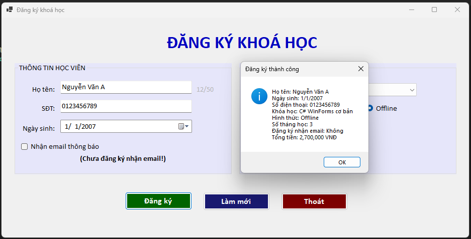
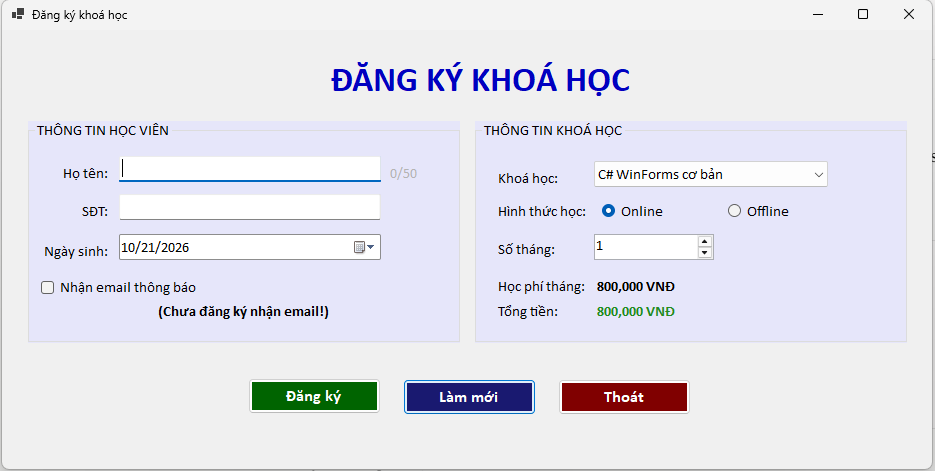
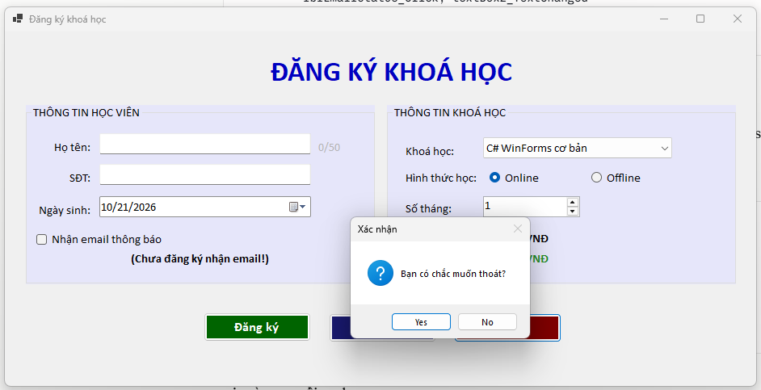

# Bài Lab 05 - Windows Forms cơ bản: Đăng ký khóa học

- **Học phần:** COMP1019 - Lập trình trên Windows
- **Họ và tên:** Đỗ Việt Hoàng
- **MSSV:** 51.01.104.031
- **Lớp:** 51.CNTT.A
- **Công cụ:** Visual Studio, Windows Forms App (C#, .NET 10)

## 1. Mô tả bài toán

Ứng dụng Windows Forms tên **CourseRegistrationApp** dùng để đăng ký khóa học. Ứng dụng chỉ xử lý dữ liệu trên Form, không lưu cơ sở dữ liệu.

## 2. Cấu trúc thư mục

```
Lab05
|-- Lab05.slnx
|-- WinFormsApp1
|   |-- CourseRegistrationApp.csproj
|   |-- Program.cs
|   `-- Form đăng ký (frmDangKyKhoaHoc)
|-- images
`-- README.md
```

## 3. Giao diện

Form gồm hai GroupBox và một vùng nút lệnh.

| Nhóm | Control | Tên | Chức năng |
| --- | --- | --- | --- |
| Thông tin học viên | TextBox | txtHoTen | Nhập họ tên (tối đa 50 ký tự, có bộ đếm ký tự) |
| Thông tin học viên | TextBox | txtSoDienThoai | Nhập số điện thoại |
| Thông tin học viên | DateTimePicker | dtpNgaySinh | Chọn ngày sinh |
| Thông tin học viên | CheckBox | chkNhanEmail | Nhận email thông báo |
| Thông tin khóa học | ComboBox | cboKhoaHoc | Chọn khóa học |
| Thông tin khóa học | RadioButton | radOnline, radOffline | Chọn hình thức học |
| Thông tin khóa học | NumericUpDown | numSoThang | Số tháng đăng ký (1 đến 12) |
| Thông tin khóa học | Label | lblHienThiHocPhi, lblTongTien | Học phí một tháng và tổng học phí |
| Nút lệnh | Button | btnDangKy, btnLamMoi, btnThoat | Đăng ký, làm mới, thoát |

## 4. Dữ liệu khóa học

| Khóa học | Học phí/tháng |
| --- | --- |
| C# WinForms cơ bản | 800.000 VNĐ |
| SQL Server cơ bản | 700.000 VNĐ |
| Web Frontend cơ bản | 750.000 VNĐ |
| Lập trình Python cơ bản | 650.000 VNĐ |

**Phụ phí:** học Offline cộng thêm **100.000 VNĐ/tháng** (theo hướng dẫn trên lớp).

Tổng học phí = (học phí một tháng + phụ phí hình thức học) x số tháng.

## 5. Chức năng

- **Khi mở Form:** nạp 4 khóa học vào ComboBox, chọn mặc định khóa đầu tiên và hình thức Online, số tháng từ 1 đến 12, hiển thị học phí ban đầu.
- **Tính học phí tự động:** cập nhật ngay khi đổi khóa học, hình thức học hoặc số tháng.
- **Nút Đăng ký:** kiểm tra dữ liệu, hiển thị phiếu đăng ký bằng MessageBox gồm họ tên, ngày sinh, số điện thoại, khóa học, hình thức, số tháng, trạng thái nhận email và tổng tiền.
- **Nút Làm mới:** xóa họ tên và số điện thoại, đưa ngày sinh về hôm nay, bỏ chọn nhận email, chọn lại khóa học đầu tiên, chọn lại Online, số tháng về 1, đưa con trỏ về ô họ tên.
- **Nút Thoát:** hỏi xác nhận, chỉ đóng Form khi chọn Yes.

## 6. Kiểm tra dữ liệu

- Họ tên không được rỗng.
- Số điện thoại phải gồm 10 chữ số và bắt đầu bằng 0.
- Phải chọn khóa học.

Khi dữ liệu sai, chương trình hiện cảnh báo và đưa con trỏ về ô nhập lỗi.

## 7. Kết quả chạy

### 7.1. Form khi vừa mở



### 7.2. Chọn hình thức Offline, tổng tiền được cập nhật



### 7.3. Lỗi khi để trống họ tên



### 7.4. Lỗi khi nhập số điện thoại sai



### 7.5. Đăng ký thành công



### 7.6. Sau khi nhấn Làm mới



### 7.7. Xác nhận khi nhấn Thoát



## 8. Cách chạy chương trình

1. Clone repo về máy.
2. Mở file `Lab05/Lab05.slnx` bằng Visual Studio.
3. Nhấn **F5** để chạy.
