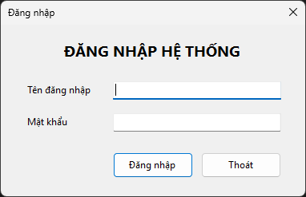
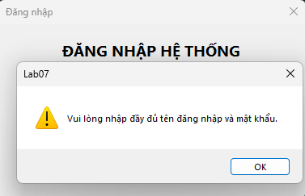
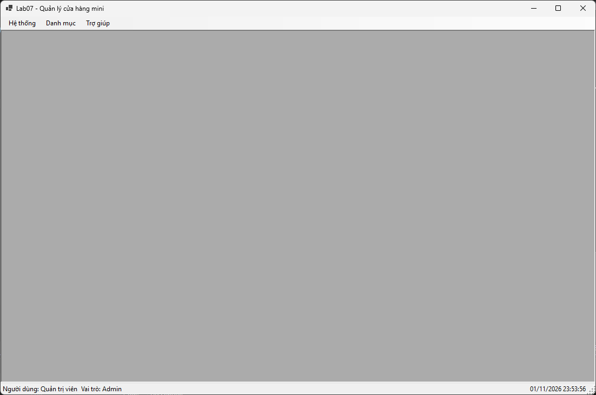
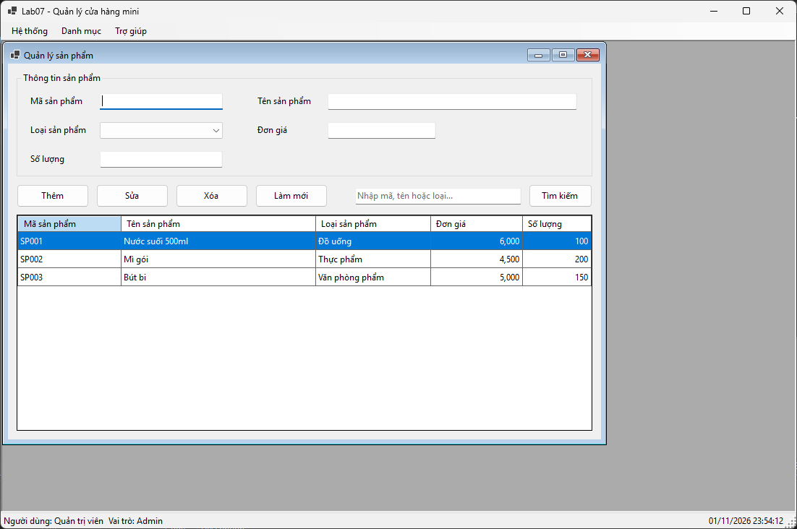
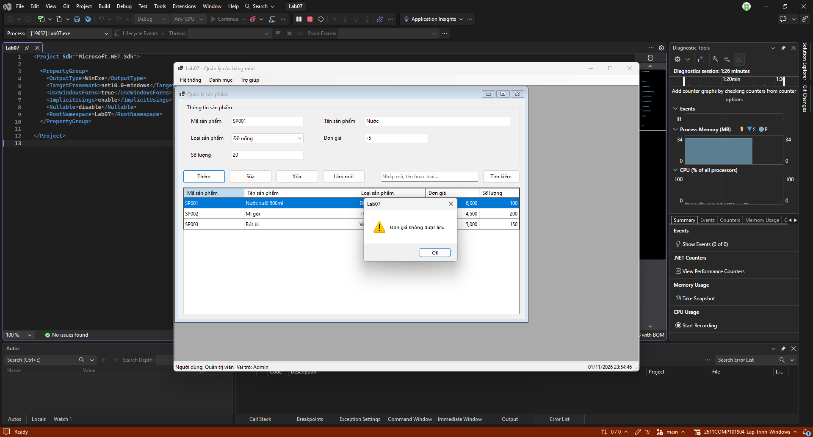
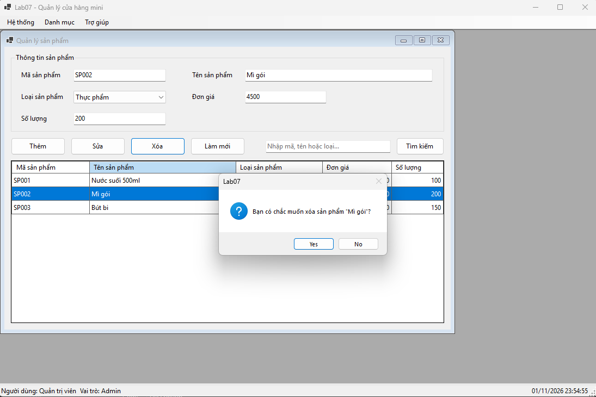
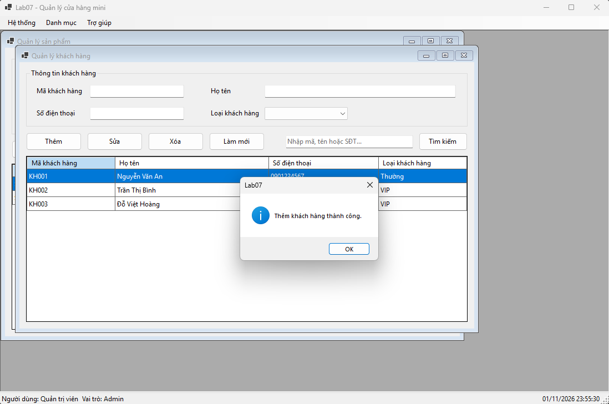
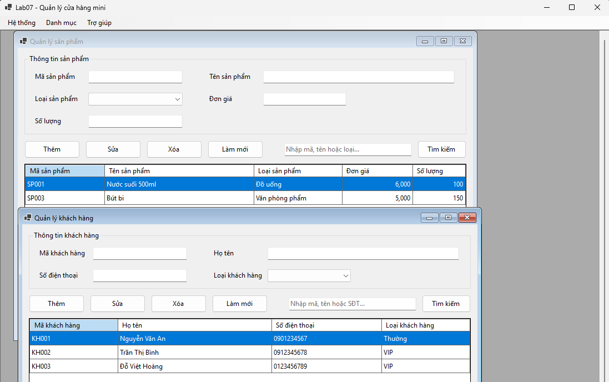
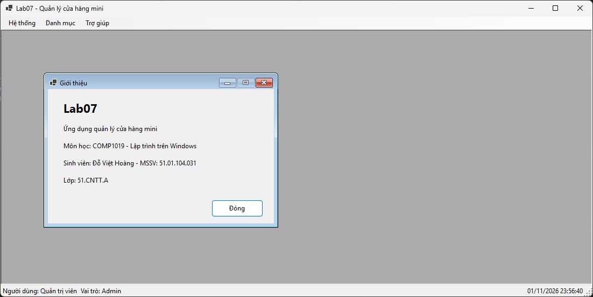
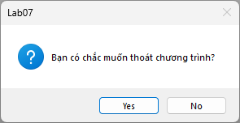

# Bài Lab 07 - SDI, MDI và ứng dụng nhiều Form

- **Học phần:** COMP1019 - Lập trình trên Windows
- **Họ và tên:** Đỗ Việt Hoàng
- **MSSV:** 51.01.104.031
- **Lớp:** 51.CNTT.A
- **Công cụ:** Visual Studio, Windows Forms App (C#, .NET 10)

## 1. Mô tả bài toán

Ứng dụng **ShopManagerMini** quản lý cửa hàng mini gồm nhiều Form: đăng nhập, Form chính dạng MDI, quản lý sản phẩm, quản lý khách hàng và giới thiệu. Dữ liệu lưu trong bộ nhớ bằng `List<T>`, chưa dùng SQL Server.

## 2. Cấu trúc thư mục

```
Lab07
|-- Lab07.slnx
|-- Lab07
|   |-- Lab07.csproj
|   |-- Program.cs
|   |-- Models
|   |   |-- User.cs, Product.cs, Customer.cs
|   |-- Forms
|   |   |-- FrmLogin, FrmMain, FrmProduct, FrmCustomer, FrmAbout
|   |-- Data
|   |   `-- DataStore.cs
|   `-- Helpers
|       `-- Msg.cs
|-- images
`-- README.md
```

## 3. Tài khoản đăng nhập mẫu

| Username | Password | Họ tên | Vai trò |
| --- | --- | --- | --- |
| admin | 123 | Quản trị viên | Admin |
| user | 123 | Nhân viên bán hàng | User |

## 4. Chức năng

| Form | Chức năng |
| --- | --- |
| FrmLogin | Kiểm tra bỏ trống, kiểm tra tài khoản mẫu, trả `DialogResult.OK` khi đúng, báo lỗi khi sai |
| FrmMain | MDI Parent (`IsMdiContainer = true`), MenuStrip (Hệ thống, Danh mục, Trợ giúp), StatusStrip hiện tên người dùng, vai trò và giờ hiện tại |
| FrmProduct | Thêm, sửa, xóa, làm mới, tìm kiếm trên `DataGridView`; không trùng mã, không cho đơn giá hoặc số lượng âm, hỏi xác nhận khi xóa |
| FrmCustomer | Thêm, sửa, xóa, tìm kiếm khách hàng trên `DataGridView` |
| FrmAbout | Thông tin ứng dụng, tên sinh viên, lớp |

Các Form con mở bên trong FrmMain và không mở trùng: nếu Form cùng loại đang mở thì kích hoạt Form cũ. Thoát chương trình và đăng xuất đều hỏi xác nhận.

## 5. Kết quả chạy

### 5.1. Form đăng nhập



### 5.2. Lỗi khi để trống hoặc nhập sai tài khoản



### 5.3. Form chính MDI sau khi đăng nhập



### 5.4. Quản lý sản phẩm



### 5.5. Lỗi khi thêm sản phẩm trùng mã hoặc nhập số âm



### 5.6. Xác nhận khi xóa sản phẩm



### 5.7. Quản lý khách hàng



### 5.8. Hai Form con mở cùng lúc trong Form chính



### 5.9. Form giới thiệu



### 5.10. Xác nhận khi thoát chương trình



## 6. Câu hỏi nộp kèm

**1. SDI và MDI khác nhau như thế nào?**
SDI (Single Document Interface): mỗi Form là một cửa sổ độc lập, mở nhiều Form là nhiều cửa sổ riêng biệt trên màn hình.
MDI (Multiple Document Interface): có một Form cha (`IsMdiContainer = true`) chứa nhiều Form con bên trong vùng làm việc của nó. Form con không ra ngoài Form cha, dùng chung menu/status bar và đóng/thu nhỏ theo Form cha.

**2. Vì sao Form đăng nhập nên dùng ShowDialog()?**
`ShowDialog()` mở Form ở chế độ modal: chặn thao tác lên các Form khác và tạm dừng code gọi cho tới khi Form đóng. Nhờ đó chương trình chỉ vào Form chính sau khi đăng nhập xong, và đọc được kết quả `DialogResult.OK` / `Cancel` để quyết định bước tiếp theo.

**3. Dữ liệu user được truyền từ FrmLogin sang FrmMain bằng cách nào?**
`FrmLogin` lưu tài khoản hợp lệ vào property `CurrentUser`. Trong `Program.cs`, sau khi `ShowDialog()` trả về `OK`, đối tượng đó được gán cho property `CurrentUser` của `FrmMain` (`new FrmMain { CurrentUser = login.CurrentUser }`). Khi `FrmMain_Load`, tên người dùng và vai trò được hiển thị trên StatusStrip.

**4. Nếu người dùng bấm menu sản phẩm nhiều lần, chương trình xử lý thế nào để không mở trùng Form?**
Hàm `ShowChild<T>()` tìm Form con cùng loại trong `MdiChildren` bằng `OfType<T>().FirstOrDefault()`. Nếu đã có thì khôi phục (nếu đang minimize) và gọi `Activate()`; nếu chưa có mới tạo Form mới với `MdiParent = this` rồi `Show()`.

**5. Khi nào nên dùng constructor, khi nào nên dùng property để truyền dữ liệu giữa các Form?**
- Constructor: dữ liệu bắt buộc, Form không thể hoạt động nếu thiếu và chỉ cần gán một lần (ví dụ Form chi tiết cần mã đối tượng). Nhược điểm: Form có constructor tham số sẽ không mở được trong Designer nếu không có constructor mặc định.
- Property: dữ liệu tùy chọn, có thể gán/đổi sau khi tạo Form, hoặc cần đọc kết quả ngược lại sau `ShowDialog()` (như `FrmLogin.CurrentUser`). Lab này dùng property để Form vẫn mở được trong Designer.

## 7. Cách chạy chương trình

1. Clone repo về máy.
2. Mở file `Lab07/Lab07.slnx` bằng Visual Studio (cần .NET 10 SDK).
3. Nhấn **F5** và đăng nhập bằng `admin` / `123`.
