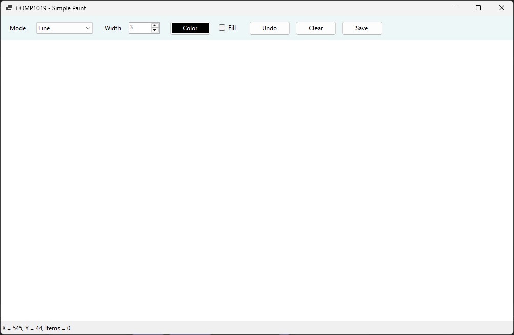
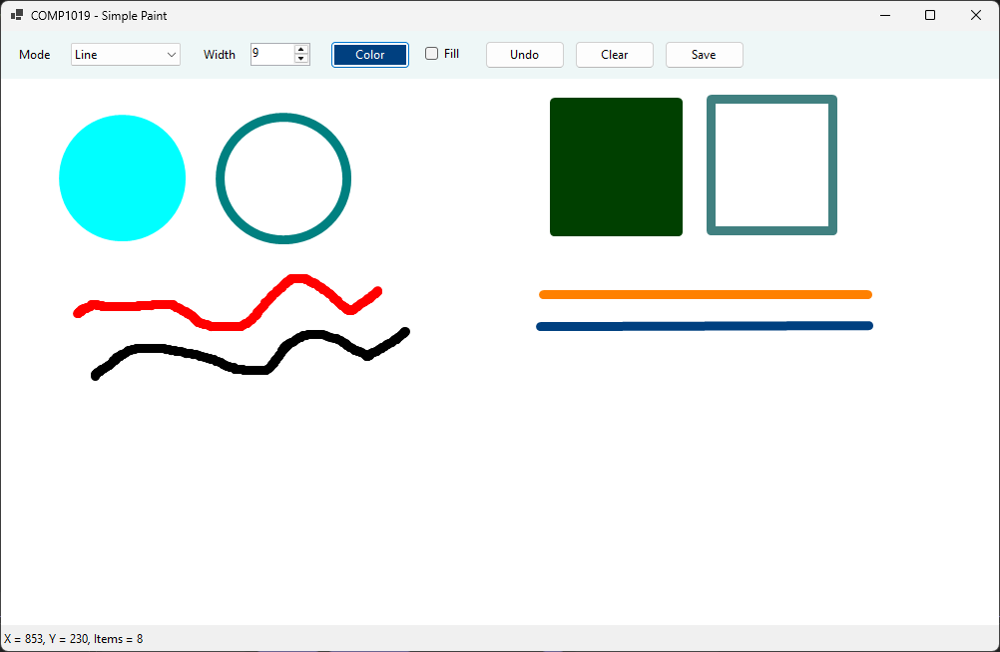
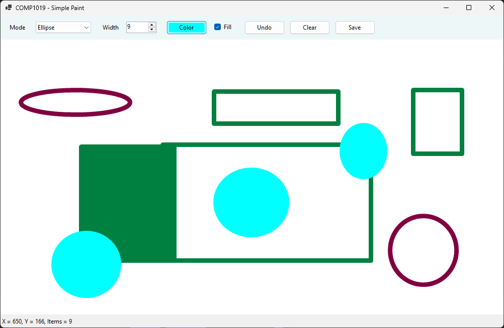
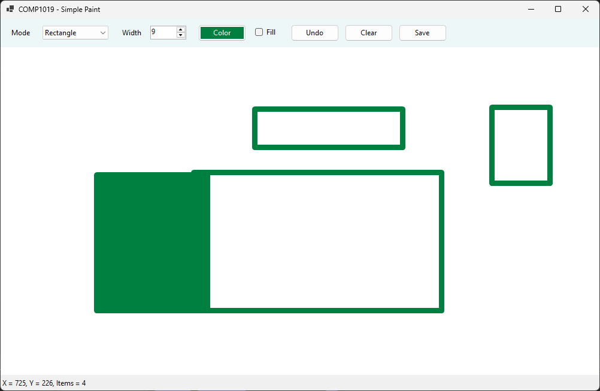
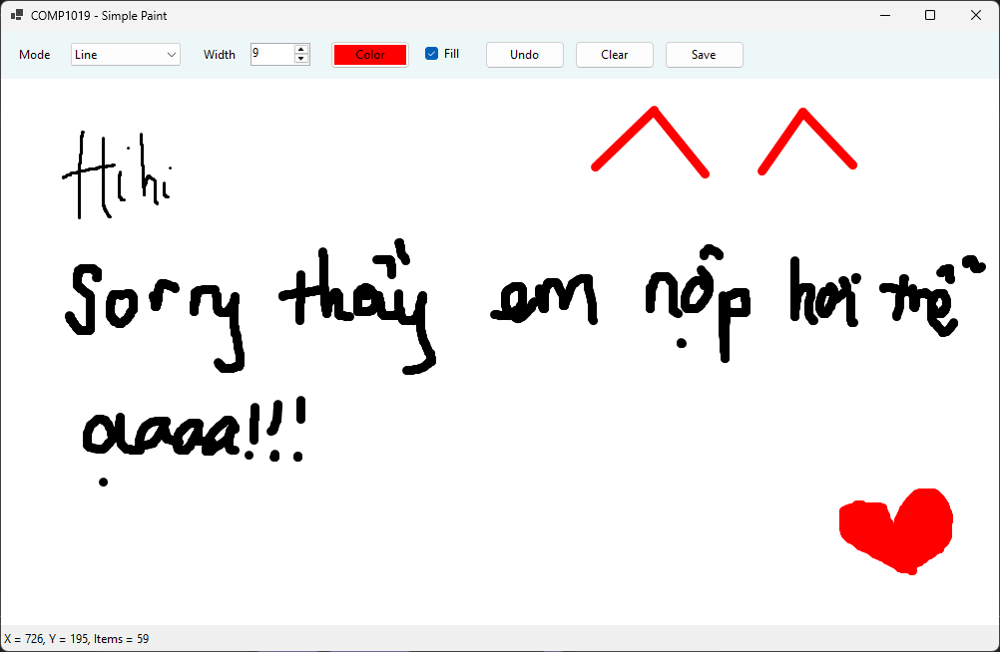
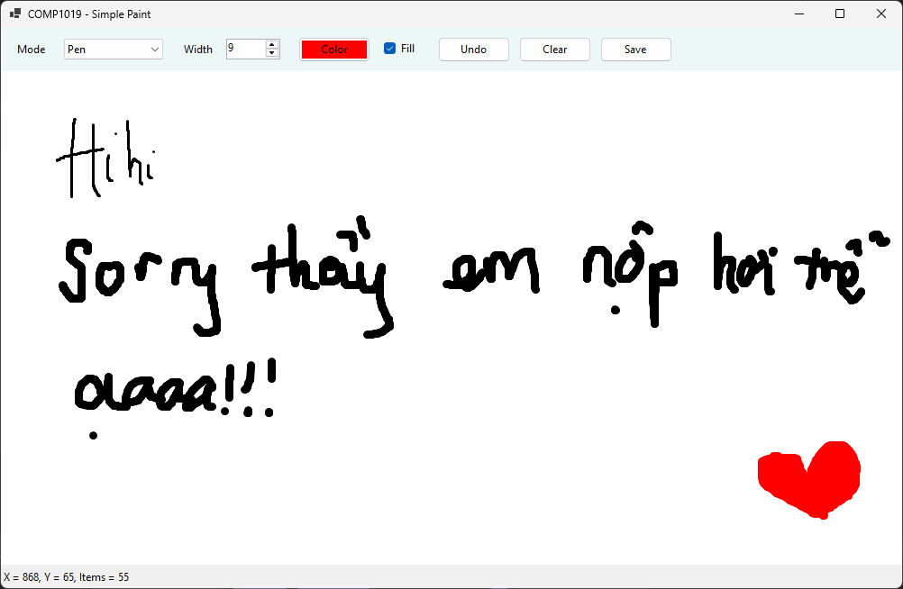

# Lab 08 - Simple Paint (WinForms + GDI+)

Học phần: COMP1019 - Lập trình trên Windows

## Cách chạy
1. Mở `Lab08.slnx` bằng Visual Studio (workload ".NET desktop development", .NET 10 SDK).
2. Nhấn Ctrl+Shift+B để build, sau đó F5 để chạy.
3. Mở Designer: double-click `FrmPaint.cs` (cần build trước vì canvas là control tùy chỉnh `DrawSurface`).

## Cách dùng
- Chọn chế độ **Pen / Line / Rectangle / Ellipse**, chọn độ dày (1-20) và màu (nút **Color**).
- Kéo chuột trái trên vùng trắng để vẽ. Tọa độ chuột hiển thị ở thanh dưới.
- **Undo** (hoặc Ctrl+Z): xóa nét vẽ gần nhất. **Clear**: xóa toàn bộ (có xác nhận).
- Nâng cao: tick **Fill** để tô màu Rectangle/Ellipse, nút **Save** lưu ra file PNG, Ctrl+Z để Undo.

## Kỹ thuật chính
- Danh sách `List<DrawItem>` lưu dữ liệu gốc, vẽ lại toàn bộ trong sự kiện `Paint` của canvas.
- Dữ liệu thay đổi thì gọi `canvas.Invalidate()`.
- `Pen`/`Brush` tạo bằng `using` để tự `Dispose`.
- `GetRectangle()` dùng `Math.Min`/`Math.Abs` để kéo chuột theo mọi hướng.
- `DrawSurface` bật `DoubleBuffered` để giảm nhấp nháy.

## Ảnh minh chứng

