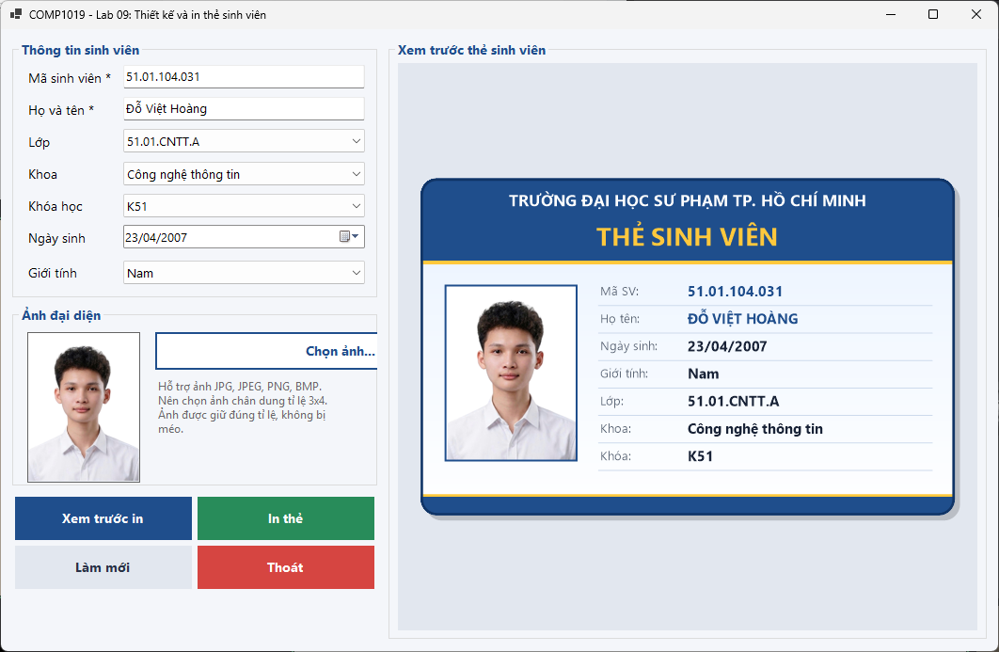
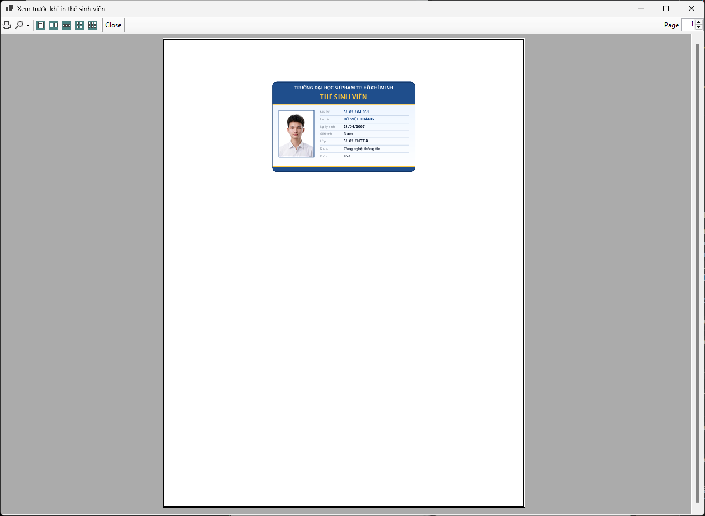
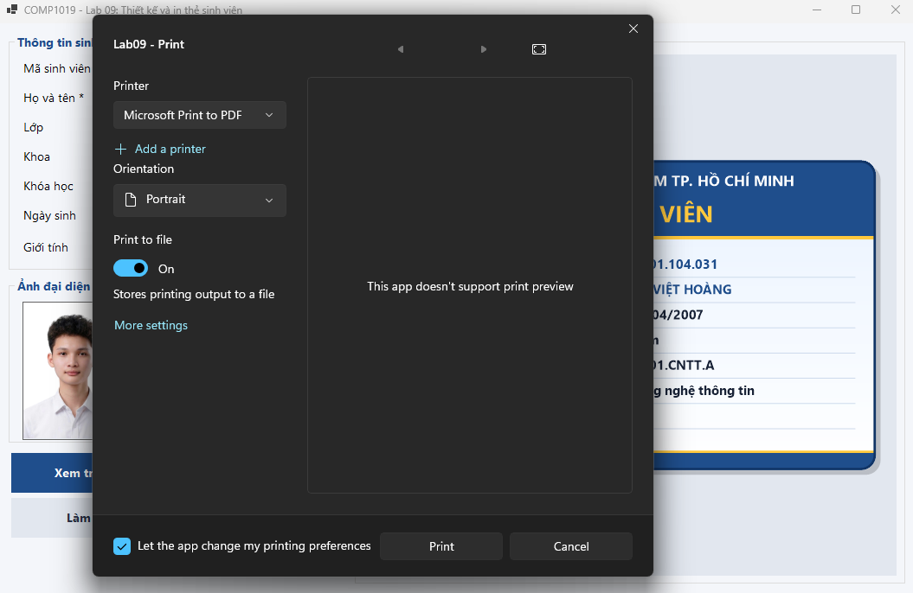
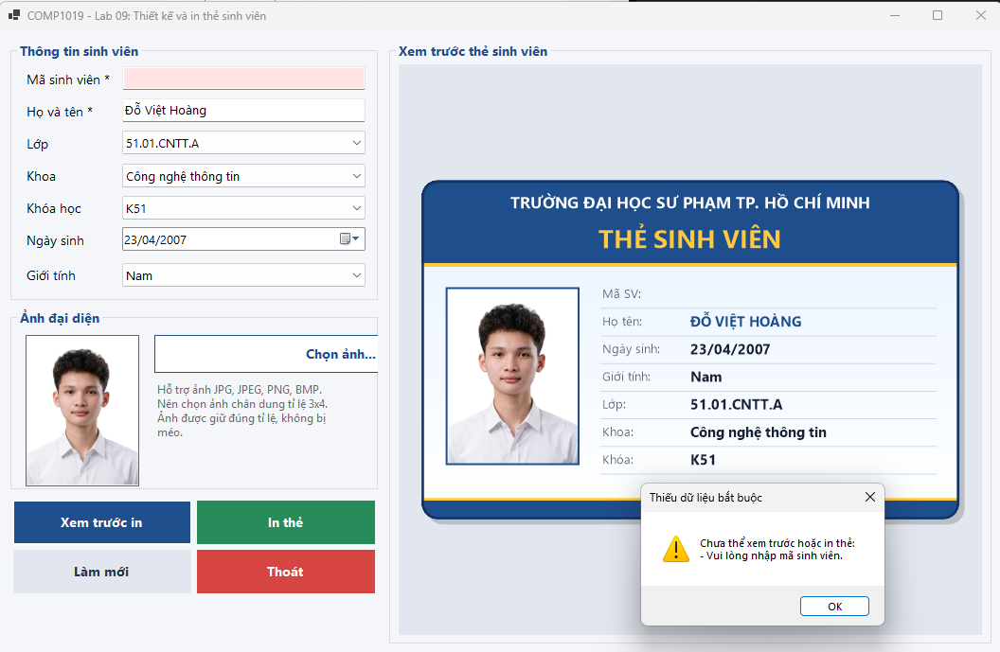
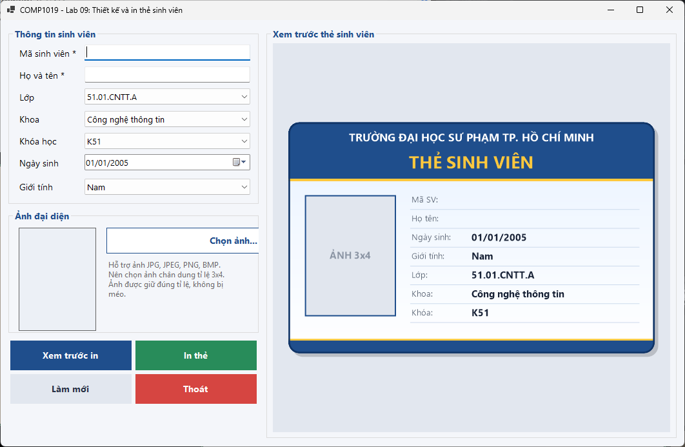

# Bài Lab 09 - Thiết kế và in thẻ sinh viên

- **Học phần:** COMP1019 - Lập trình trên Windows
- **Họ và tên:** Đỗ Việt Hoàng
- **MSSV:** 51.01.104.031
- **Lớp:** 51.CNTT.A
- **Công cụ:** Visual Studio, Windows Forms App (C#, .NET 10), GDI+, PrintDocument

## 1. Mô tả bài toán

Ứng dụng Windows Forms cho phép nhập thông tin sinh viên, chọn ảnh đại diện, xem trước thẻ sinh viên được vẽ bằng GDI+ trên Panel, sau đó xem trước bản in và in thẻ bằng `PrintDocument`. Ứng dụng không dùng cơ sở dữ liệu.

## 2. Cấu trúc thư mục

```
Lab09
|-- Lab09.slnx
|-- Lab09
|   |-- Lab09.csproj
|   |-- Program.cs
|   |-- FrmStudentCard.cs
|   |-- FrmStudentCard.Designer.cs
|   |-- CustomControls
|   |   `-- BufferedPanel.cs
|   |-- Helpers
|   |   `-- CardRenderer.cs
|   `-- Models
|       `-- StudentInfo.cs
|-- images
`-- README.md
```

## 3. Chức năng

| Mã | Chức năng | Giải pháp |
| --- | --- | --- |
| F1 | Chọn ảnh | `OpenFileDialog` lọc JPG, JPEG, PNG, BMP; tạo bản copy `Bitmap` để không khóa file gốc; `PictureBox` dùng chế độ Zoom |
| F2 | Preview thẻ | Vẽ bằng GDI+ trong sự kiện `Paint` của `BufferedPanel`, gọi `Invalidate()` khi dữ liệu thay đổi |
| F3 | Validation | Bắt buộc có mã sinh viên, họ tên và ảnh; thiếu thì cảnh báo, focus về ô lỗi, không cho xem trước hoặc in |
| F4 | Xem trước in | `PrintPreviewDialog` + `PrintDocument` |
| F5 | In | `PrintDialog` chọn máy in, nội dung vẽ trong `PrintPage` bằng chung hàm vẽ thẻ với preview |
| F6 | Làm mới | Xóa dữ liệu nhập, giải phóng ảnh, đưa form về trạng thái ban đầu |

## 4. Test case

| Mã | Tình huống | Thao tác | Kết quả mong đợi | Kết quả |
| --- | --- | --- | --- | --- |
| TC01 | Khởi tạo | Chạy chương trình | Các ComboBox có dữ liệu, preview hiển thị thẻ trống | PASS |
| TC02 | Chọn ảnh hợp lệ | Bấm Chọn ảnh, chọn file JPG | Ảnh hiện trong PictureBox không méo, thẻ cập nhật ảnh | PASS |
| TC03 | Đổi ảnh | Chọn ảnh A rồi chọn ảnh B | Không lỗi, không khóa file | PASS |
| TC04 | Preview tự cập nhật | Nhập mã, họ tên, đổi lớp | Thẻ vẽ lại ngay, không nhấp nháy | PASS |
| TC05 | Thiếu mã hoặc họ tên | Để trống rồi bấm Xem trước in | Hiện cảnh báo, không mở preview | PASS |
| TC06 | Thiếu ảnh | Nhập đủ chữ, chưa chọn ảnh, bấm In thẻ | Hiện cảnh báo thiếu ảnh | PASS |
| TC07 | Xem trước in | Nhập đủ dữ liệu, bấm Xem trước in | Mở PrintPreviewDialog, thẻ hiển thị đúng | PASS |
| TC08 | Làm mới | Bấm Làm mới khi đang có dữ liệu | Xóa dữ liệu và ảnh, về trạng thái ban đầu | PASS |

## 5. Kết quả chạy

### 5.1. Form khi vừa mở


### 5.2. Nhập đủ dữ liệu và chọn ảnh



### 5.3. Xem trước bản in



### 5.4. Hộp thoại In



### 5.5. Lỗi khi thiếu dữ liệu bắt buộc



### 5.6. Sau khi nhấn Làm mới



## 6. Cách chạy chương trình

1. Clone repo về máy.
2. Mở file `Lab09/Lab09.slnx` bằng Visual Studio (cần .NET 10 SDK).
3. Nhấn **F5** để chạy.
