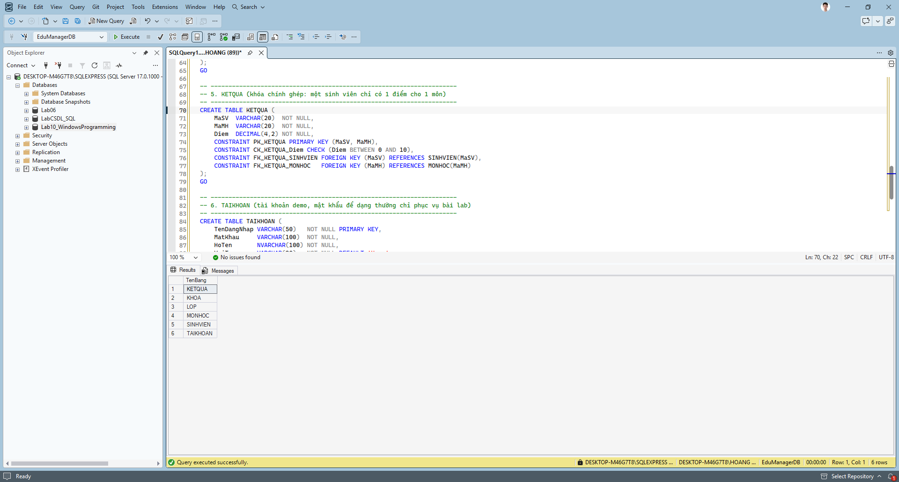
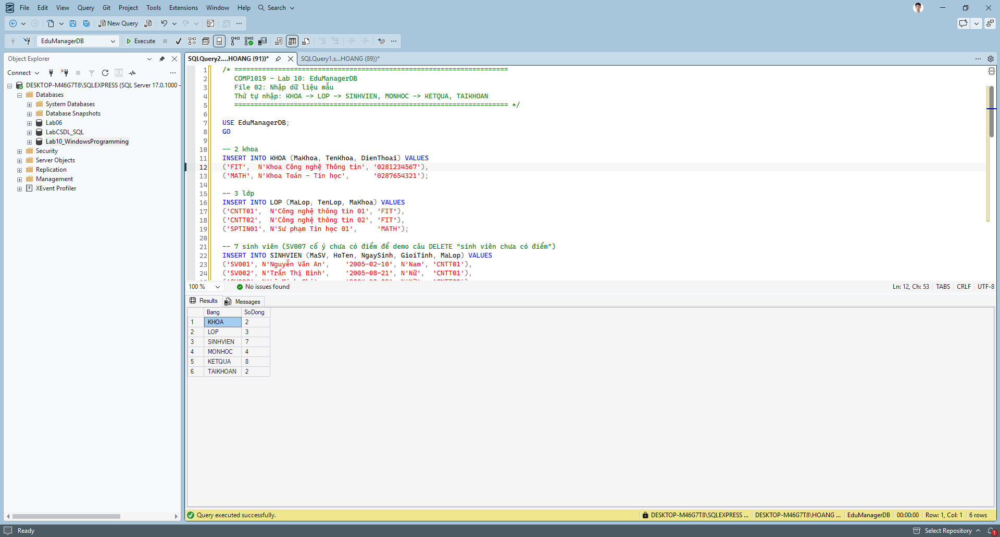
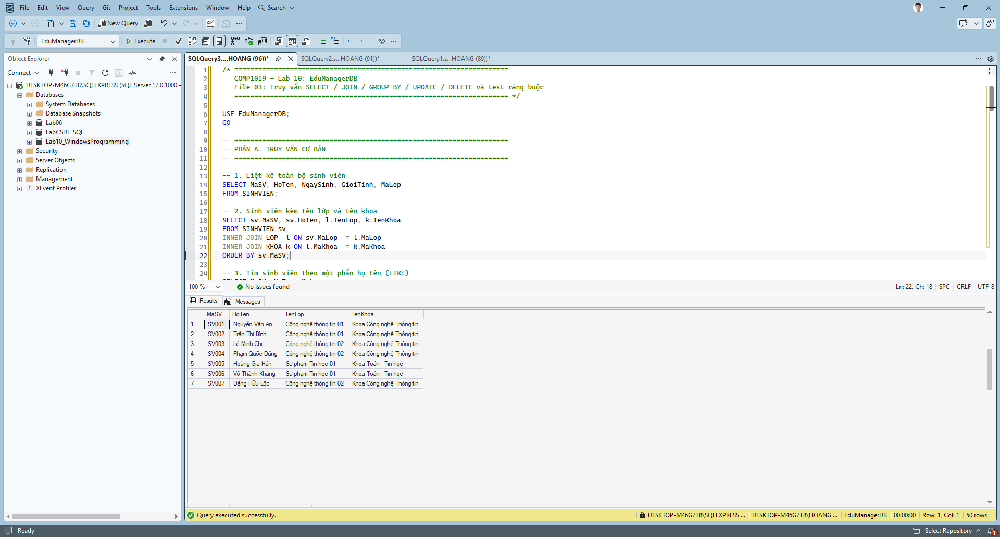
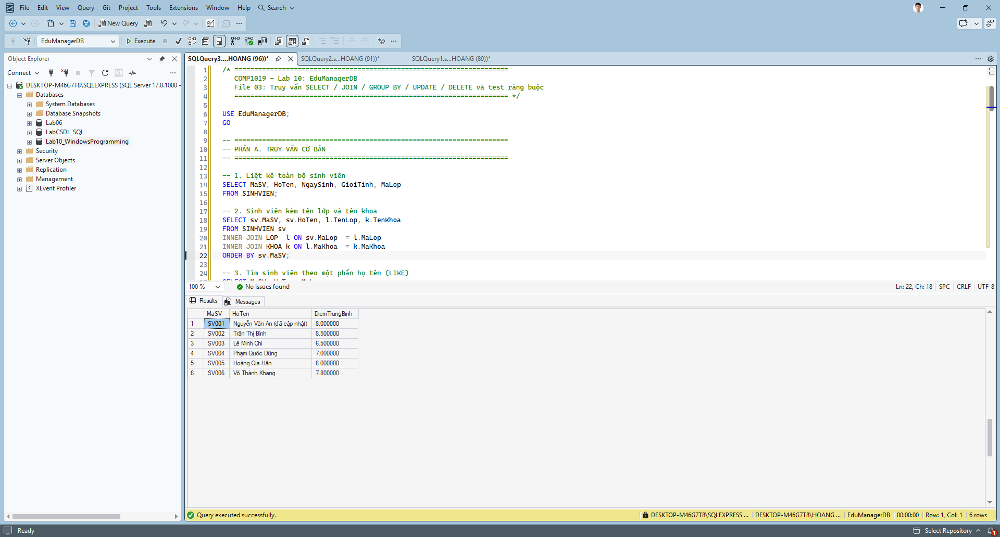
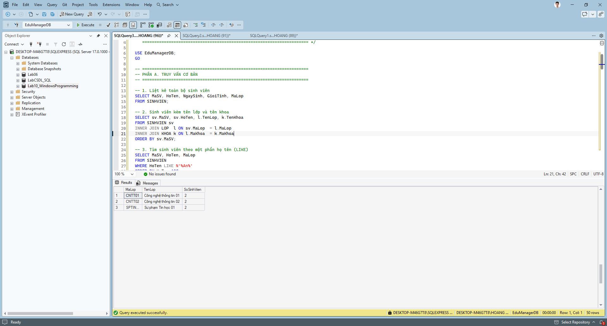
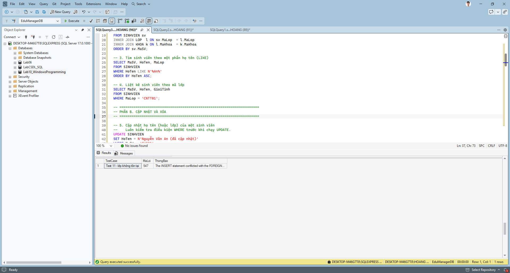
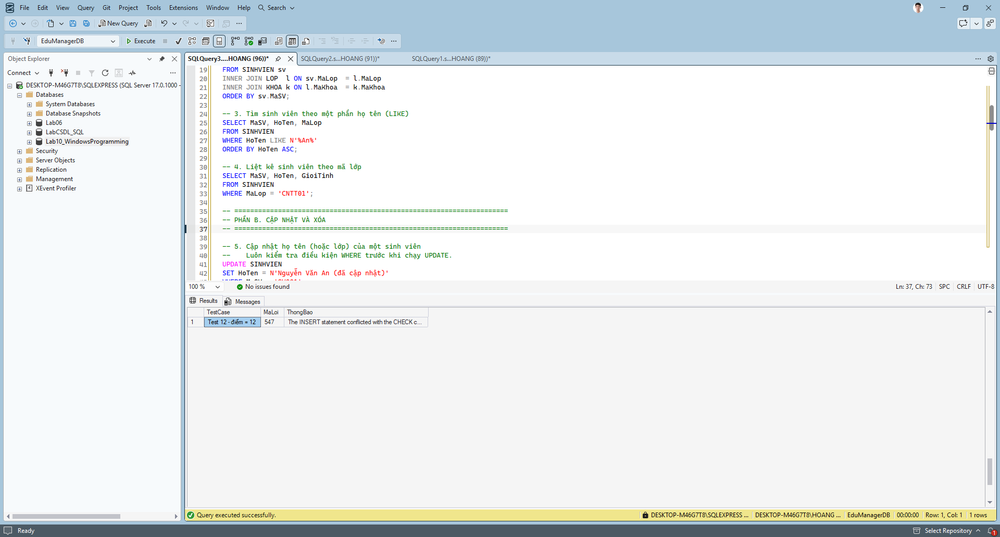

# Lab 10 - Thiết kế và cài đặt CSDL EduManagerDB (SQL Server)

Học phần: COMP1019 - Lập trình trên Windows

## Các file
| File | Nội dung |
| --- | --- |
| `01_CreateDatabase.sql` | Tạo database, 6 bảng, khóa chính, khóa ngoại, ràng buộc CHECK |
| `02_InsertSampleData.sql` | Dữ liệu mẫu: 2 khoa, 3 lớp, 7 sinh viên, 4 môn, 8 kết quả, 2 tài khoản |
| `03_Queries.sql` | 10 truy vấn SELECT/JOIN/GROUP BY/UPDATE/DELETE và 5 test lỗi ràng buộc |

## Cách chạy
1. Mở SSMS, kết nối vào SQL Server.
2. Mở và chạy (F5) lần lượt `01` -> `02` -> `03`.
3. File `01` có thể chạy lại nhiều lần (tự xóa database cũ).

## Thiết kế
- `KHOA` 1-n `LOP` 1-n `SINHVIEN` 1-n `KETQUA` n-1 `MONHOC`; `TAIKHOAN` độc lập.
- `KETQUA` dùng khóa chính ghép (MaSV, MaMH).
- CHECK: `Diem` 0..10, `GioiTinh` in (Nam, Nữ), `SoTinChi` > 0.

## Ảnh minh chứng

