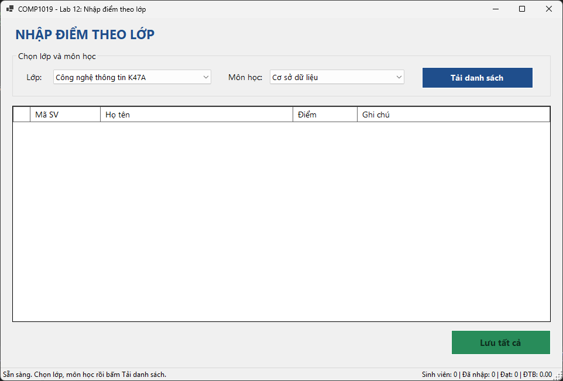
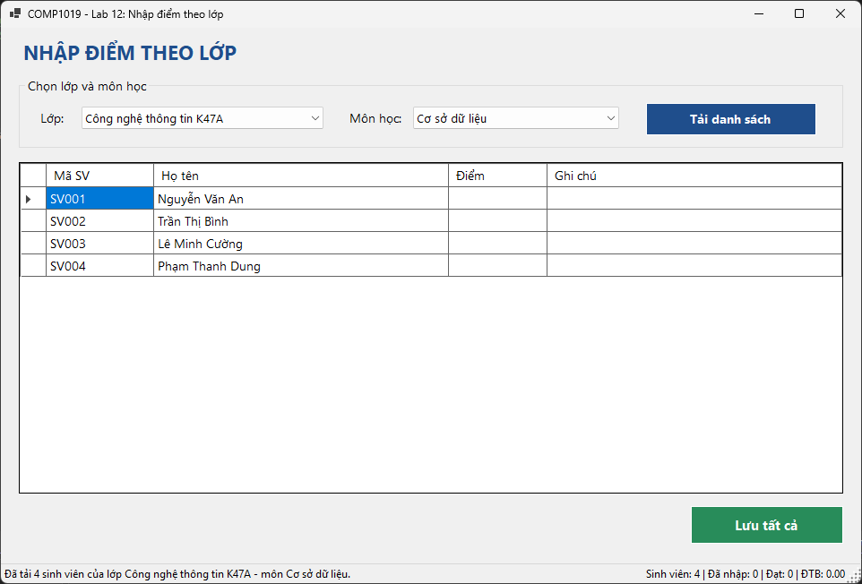
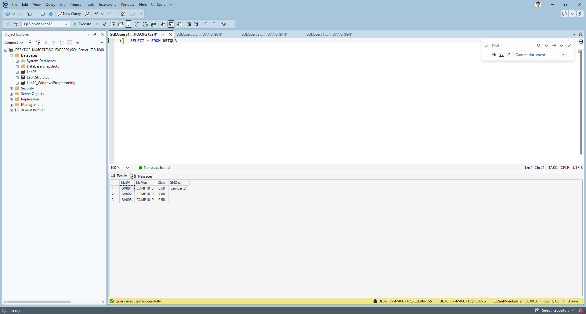
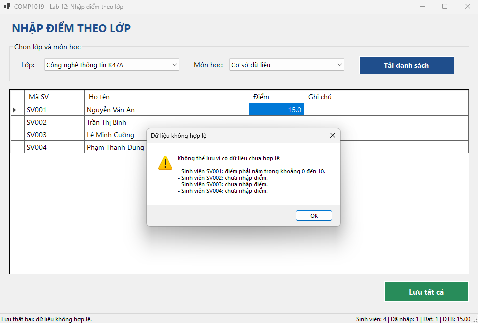
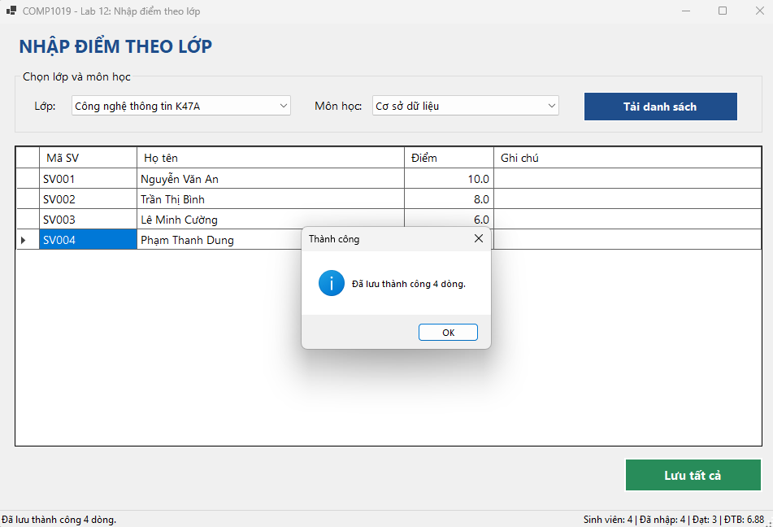
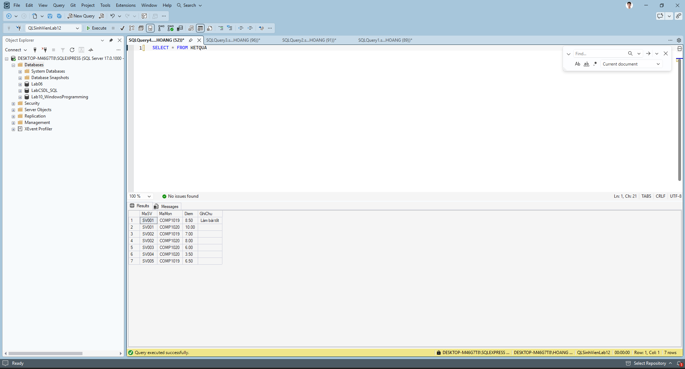

# Bài Lab 12 - Data Binding, Stored Procedure và Transaction

- **Học phần:** COMP1019 - Lập trình trên Windows
- **Họ và tên:** Đỗ Việt Hoàng
- **MSSV:** 51.01.104.031
- **Lớp:** 51.CNTT.A
- **Công cụ:** Visual Studio, Windows Forms App (C#, .NET 10), SQL Server, ADO.NET, Microsoft.Data.SqlClient

## 1. Mô tả bài toán

Module **Quản lý kết quả học tập**: chọn lớp, chọn môn học, hệ thống hiển thị danh sách sinh viên của lớp kèm điểm (nếu đã có). Người dùng nhập hoặc sửa điểm và ghi chú rồi bấm **Lưu tất cả**. Nếu mọi dữ liệu hợp lệ thì lưu xuống database trong một transaction; nếu có bất kỳ dòng nào lỗi thì hủy (rollback) toàn bộ.

## 2. Cấu trúc thư mục

```
Lab12
|-- Lab12.slnx
|-- Lab12
|   |-- Lab12.csproj
|   |-- Program.cs
|   |-- Forms
|   |   |-- FrmNhapDiemTheoLop.cs
|   |   `-- FrmNhapDiemTheoLop.Designer.cs
|   `-- DAL
|       |-- Database.cs
|       `-- KetQuaDAL.cs
|-- Database
|   `-- QLSinhVienLab12.sql
|-- images
`-- README.md
```

## 3. Cơ sở dữ liệu

Database **QLSinhVienLab12** gồm 4 bảng: `LOP`, `SINHVIEN`, `MONHOC`, `KETQUA`.

- `KETQUA` có khóa chính kép (`MaSV`, `MaMon`) nên mỗi sinh viên chỉ có một điểm cho một môn.
- Khóa ngoại: `SINHVIEN.MaLop` tham chiếu `LOP`, `KETQUA.MaSV` tham chiếu `SINHVIEN`, `KETQUA.MaMon` tham chiếu `MONHOC`.
- Ràng buộc `CHECK`: `Diem` từ 0 đến 10, `SoTinChi` lớn hơn 0.
- Dữ liệu mẫu: 3 lớp, 10 sinh viên, 3 môn học, 3 điểm có sẵn.

| Stored procedure | Chức năng |
| --- | --- |
| `sp_Lop_GetAll` | Lấy danh sách lớp |
| `sp_MonHoc_GetAll` | Lấy danh sách môn học |
| `sp_KetQua_GetByLopMon` | Lấy sinh viên theo lớp và môn, kèm điểm nếu đã có (chưa có thì để trống) |
| `sp_KetQua_Save` | Đã có điểm thì `UPDATE`, chưa có thì `INSERT`; từ chối điểm ngoài 0 đến 10 |

## 4. Giao diện

| Control | Tên | Chức năng |
| --- | --- | --- |
| ComboBox | cboLop | Chọn lớp |
| ComboBox | cboMonHoc | Chọn môn học |
| Button | btnTaiDanhSach | Tải danh sách sinh viên |
| DataGridView | dgvKetQua | Hiển thị Mã SV, Họ tên, Điểm, Ghi chú (chỉ sửa được Điểm và Ghi chú) |
| Button | btnLuuTatCa | Lưu toàn bộ điểm |
| StatusStrip | lblStatus, lblThongKe | Trạng thái thao tác và thống kê nhanh |

## 5. Kỹ thuật đã áp dụng

- **Data binding:** `DataTable` + `BindingSource` gắn vào `DataGridView`; ComboBox dùng `DisplayMember`, `ValueMember`, `DataSource`.
- **Phân tầng:** Form chỉ xử lý giao diện, mọi truy cập database nằm trong `KetQuaDAL`; chuỗi kết nối nằm trong `Database.cs`.
- **Parameter:** gọi stored procedure bằng `SqlParameter` có kiểu rõ ràng, không nối chuỗi SQL.
- **Transaction:** `SaveAll` mở `SqlTransaction`, lưu từng dòng, `Commit` khi tất cả thành công, `Rollback` khi có lỗi.
- **Validation:** điểm không rỗng, là số, nằm trong 0 đến 10; dòng lỗi được đánh dấu biểu tượng lỗi; gõ chữ vào ô điểm được bắt bằng `DataError`.
- **Mở rộng:** thống kê nhanh (số sinh viên, đã nhập, đạt, điểm trung bình) trên StatusStrip.

## 6. Test case

| Mã | Tình huống | Thao tác | Kết quả mong đợi | Kết quả |
| --- | --- | --- | --- | --- |
| TC01 | Load Form | Chạy chương trình | ComboBox có đủ lớp và môn học | PASS |
| TC02 | Tải danh sách | Chọn CTK47A, COMP1019, bấm Tải danh sách | Hiện 4 sinh viên, SV001 và SV002 đã có điểm | PASS |
| TC03 | Nhập điểm hợp lệ | Nhập điểm cho SV003, SV004, bấm Lưu tất cả | Báo lưu thành công 4 dòng | PASS |
| TC04 | Sửa điểm đã có | Đổi điểm SV001, bấm Lưu tất cả | Điểm được cập nhật, không thêm dòng mới | PASS |
| TC05 | Để trống điểm | Xóa điểm một sinh viên, bấm Lưu tất cả | Cảnh báo chưa nhập điểm, không lưu | PASS |
| TC06 | Điểm ngoài khoảng | Nhập 15, bấm Lưu tất cả | Cảnh báo điểm phải từ 0 đến 10, không lưu | PASS |
| TC07 | Nhập chữ vào ô điểm | Gõ `abc` vào ô điểm | Báo điểm phải là số, chương trình không bị dừng | PASS |
| TC08 | Rollback | Xem mục 7 | Báo lỗi, database không thay đổi dòng nào | PASS |

## 7. Kiểm thử rollback

Validation phía Form sẽ chặn điểm sai trước khi gọi database, nên để thấy rollback hoạt động cần tạm vô hiệu hóa bước này:

1. Trong `btnLuuTatCa_Click`, tạm comment khối `if (errors.Count > 0) { ... }` ngay sau dòng `KiemTraDuLieu()`.
2. Tải CTK47A - COMP1019, nhập điểm hợp lệ cho SV003, nhập `15` cho SV004, bấm Lưu tất cả.
3. Stored procedure ném lỗi ở dòng SV004, chương trình báo rollback; chạy `SELECT * FROM KETQUA` thì điểm hợp lệ của SV003 cũng **không** được lưu.
4. Bỏ comment trả code về như cũ.

## 8. Kết quả chạy

### 8.1. Form khi vừa mở



### 8.2. Tải danh sách sinh viên



### 8.3. Dữ liệu trong SQL Server trước khi lưu



### 8.4. Lỗi khi nhập điểm sai



### 8.5. Lưu thành công



### 8.6. Dữ liệu trong SQL Server sau khi lưu



### 8.7. Rollback khi có dòng lỗi


## 9. Cách chạy chương trình

1. Mở SSMS, chạy file `Database/QLSinhVienLab12.sql` để tạo database và dữ liệu mẫu.
2. Mở file `Lab12/Lab12.slnx` bằng Visual Studio (cần .NET 10 SDK); NuGet tự khôi phục `Microsoft.Data.SqlClient`.
3. Nếu dùng SQL Server Express, sửa `Data Source=.` thành `Data Source=.\SQLEXPRESS` trong `Lab12/DAL/Database.cs`.
4. Nhấn **F5** để chạy.
