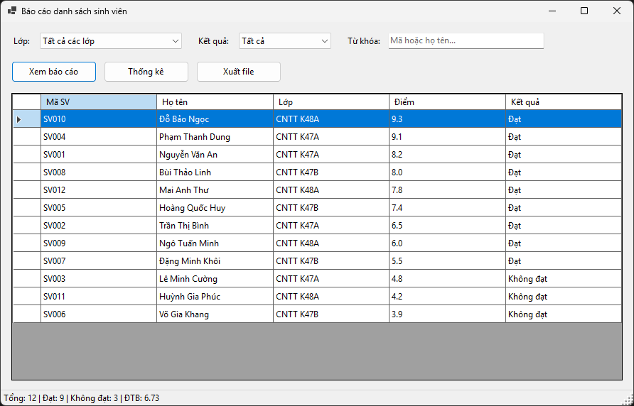
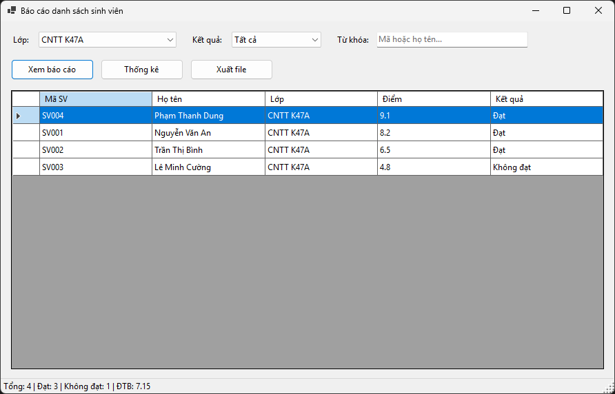
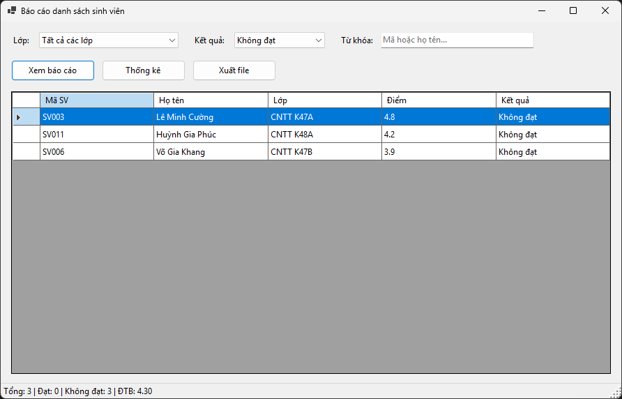
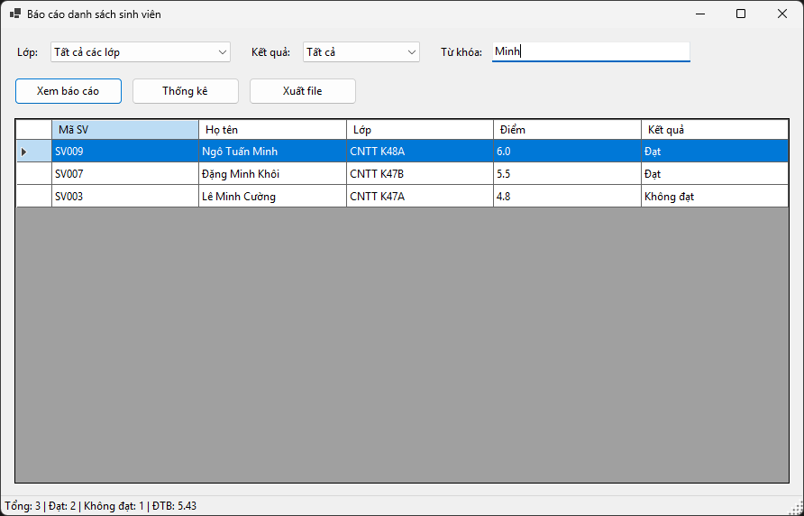
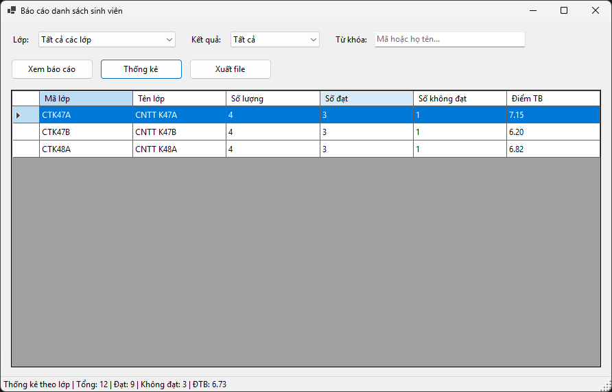
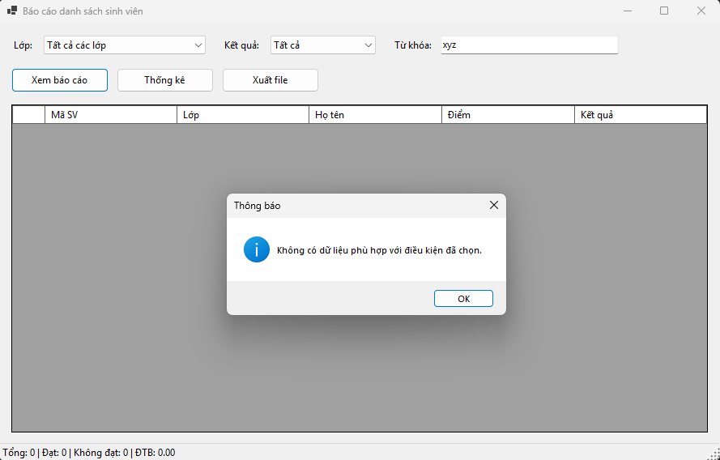
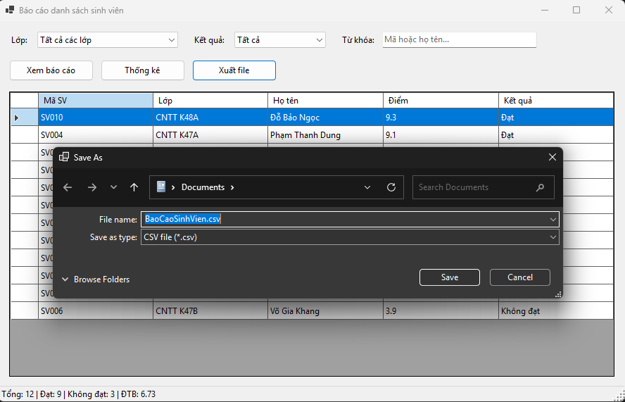
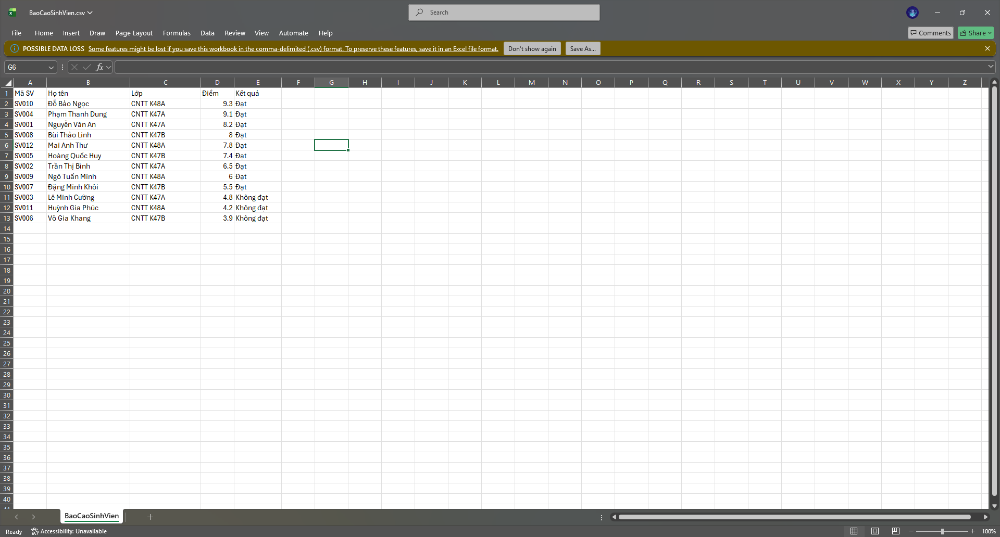

# Lab 13 - Báo cáo sinh viên bằng LINQ (WinForms)

Học phần: COMP1019 - Lập trình trên Windows

## Cách chạy
1. Mở `Lab13.slnx` bằng Visual Studio (workload ".NET desktop development", .NET 10 SDK).
2. Nhấn Ctrl+Shift+B để build, sau đó F5 để chạy.
3. Mở Designer: double-click `Lab13/Forms/FrmBaoCaoSinhVien.cs`.

## Chức năng
- Dữ liệu mẫu 12 sinh viên, 3 lớp (CTK47A, CTK47B, CTK48A), tạo trong `TaoDuLieuMau()`.
- **Xem báo cáo**: lọc theo lớp (có mục "Tất cả các lớp"), kết quả (Tất cả / Đạt / Không đạt) và từ khóa (mã hoặc họ tên). Kết quả sắp xếp giảm dần theo điểm.
- **Thống kê**: số sinh viên, số đạt, số không đạt và điểm trung bình theo từng lớp (`GroupBy`).
- **Xuất file**: lưu dữ liệu đang hiển thị ra CSV hoặc TXT (có xử lý dấu phẩy, lỗi ghi file).
- Thanh trạng thái hiển thị tổng số, số đạt, số không đạt, điểm trung bình.
- Không có dữ liệu phù hợp thì báo cho người dùng.

## LINQ đã dùng
`Where`, `OrderByDescending`, `ThenBy`, `Select`, `Distinct`, `GroupBy`, `Count`, `Average`, `Any`.

## Ảnh minh chứng

## File báo cáo đã xuất
- `output/BaoCaoSinhVien.csv`
